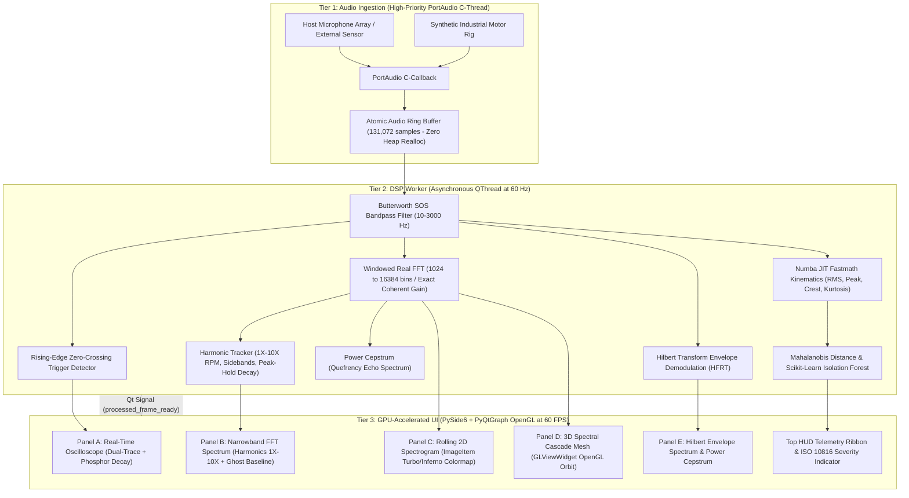

# GPU-Accelerated Mechanical Vibration Analyzer & Acoustic Diagnostic Workstation

An industrial-grade, GPU-accelerated workstation application for **real-time mechanical vibration analysis**, **high-frequency resonance technique (HFRT) bearing demodulation**, and **predictive machine health monitoring** using laptop microphones or external accelerometers.

Built on **PySide6**, **PyQtGraph with OpenGL hardware acceleration**, **SoundDevice (PortAudio C-level callback)**, **Numba JIT**, and **Scikit-Learn**.

---

## 1. Modular Architecture & Concurrency Model

```
vibration_analyzer/
├── audio_engine.py         # PortAudio C-callback stream ingestion & atomic ring buffer
├── dsp_worker.py           # QThread worker, Numba JIT statistics, Hilbert demodulation, Cepstrum, FFT
├── views.py                # 5 modular QDockWidgets (Oscilloscope, FFT, 2D Spectrogram, 3D GL Cascade, HFRT)
├── app.py                  # PySide6 workstation orchestration, docking, flight recorder, baseline snapshot
├── synthetic_generator.py  # Industrial multi-fault rig simulator (unbalance, misalignment, looseness, BPFO/BPFI)
├── web_app.py              # Companion Streamlit + Plotly reactive web dashboard
├── requirements.txt        # Workstation dependencies (PySide6, PyOpenGL, pyqtgraph, numba, sounddevice)
└── tests/                  # 12-test automated verification test suite
    ├── test_dsp.py
    ├── test_detector.py
    └── test_workstation.py
```

### Decoupled 3-Tier Multi-Threaded Engine


---

## 2. Multi-Modal Diagnostic Viewports

### Panel A: Real-Time Oscilloscope (Time-Domain)
- **Dual-Trace Display**: Raw acoustic waveform (dim slate cyan) vs. bandpass-filtered vibration proxy (cyber cyan neon).
- **Rising-Edge Triggering**: Software zero-crossing trigger search to stabilize periodic mechanical rotations on screen.
- **Phosphor Decay Persistence**: Renders previous cycle trails with alpha attenuation to expose cycle-to-cycle jitter.

### Panel B: Live Narrowband FFT Spectrum & Harmonic Cursor
- Single-sided amplitude spectrum ($0\text{ to }10\text{ kHz}$ or Nyquist) in linear or logarithmic dBV scale.
- **Automated 1X-10X Harmonic Cursors**: Automatically identifies fundamental shaft speed ($f_0 \times 60 = \text{RPM}$) and tracks orders $2\times, 3\times, \dots, 10\times$.
- **Sideband Markers**: Highlights Gearmesh ($GMF$) and bearing ball-pass outer race defect frequencies ($BPFO \approx 3.56 \times f_0$).
- **Decaying Peak-Hold Trace**: Tracks maximum historical spectral peaks with exponential decay.
- **Baseline Snapshot Ghost Overlay**: Freezes a frozen purple ghost trace (`#bf5af2`) of nominal spectrum to visually monitor drift.
- **Interactive Crosshair & Delta Cursor**: Real-time inspection of frequency (Hz), amplitude (dBV / g), and order.

### Panel C: GPU-Accelerated Rolling 2D Spectrogram
- Renders 30 to 60 seconds of rolling history via `pyqtgraph.ImageItem`.
- Selectable high dynamic range colormaps: `turbo`, `inferno`, `viridis`, `plasma`.
- Visualizes run-up, coast-down, and transient mechanical impact trajectories.

### Panel D: 3D Waterfall / Spectral Cascade Plot (OpenGL)
- Interactive 3D perspective waterfall using `pyqtgraph.opengl.GLViewWidget` and `GLSurfacePlotItem`.
- Real-time 3D frequency vs. time vs. amplitude surface with interactive mouse orbit, pan, and zoom.

### Panel E: Cepstrum & Envelope Demodulation (HFRT)
- **Analytic Signal via Hilbert Transform**: Exposes bearing raceway impact modulation buried under high-frequency structural resonances.
- **Power Cepstrum**: Logarithmic power spectrum transformation plotting quefrency (ms) to detect periodic harmonic spacing and gear tooth click echoes.

---

## 3. Top HUD Ribbon & ISO 10816 Severity Classification

- **Fundamental Running Speed**: Instantaneous RPM ($f_0 \times 60$) and fundamental Hz.
- **RMS Velocity & Acceleration**: Calibrated kinematic proxies in mm/s and g.
- **Crest Factor & Kurtosis ($\kappa$)**: Impulse metrics ($\kappa \approx 3.0$ for Gaussian noise, $\kappa > 4.5$ for bearing spall shock trains).
- **Machine Health Index (0% to 100%)**: Combined Mahalanobis distance and Isolation Forest outlier score.
- **ISO 10816 Severity Zones**:
  - **Zone A (Green)**: Good / Newly commissioned condition.
  - **Zone B (Cyan)**: Acceptable for unrestricted continuous operation.
  - **Zone C (Amber)**: Alert / Unsatisfactory; plan corrective maintenance.
  - **Zone D (Crimson)**: Danger / Unacceptable; stop machine immediately.

---

## 4. Session Flight Recorder & Data Export

- **Synchronized WAV Audio**: Saves uncompressed 16-bit PCM WAV audio.
- **Telemetry CSV Log**: Synchronized time-stamped log containing RPM, RMS velocity, peak amplitude, crest factor, kurtosis, THD %, health index, ISO zone, and fault attribution.
- Stored directly in `vibration_analyzer/flight_recordings/`.

---

## 5. Quick Launch Instructions

### 1. Launch Master Workstation via Batch File
Double-click [`Launch_Vibration_Analyzer.bat`](file:///c:/Users/hp/Desktop/Github%20projects/ML/plant-disease-classifier/Launch_Vibration_Analyzer.bat) or run:
```powershell
.\Launch_Vibration_Analyzer.bat
```
*Select option `[1]` to launch the 60 FPS GPU-accelerated workstation.*

### 2. Direct Python Launch
```powershell
python run_vibration_analyzer.py
```

### 3. Launch Web Companion (Streamlit + Plotly)
```powershell
python run_vibration_analyzer.py --web
```

### 4. Run Test Suite
```powershell
python -m pytest vibration_analyzer/tests/ -v
```
